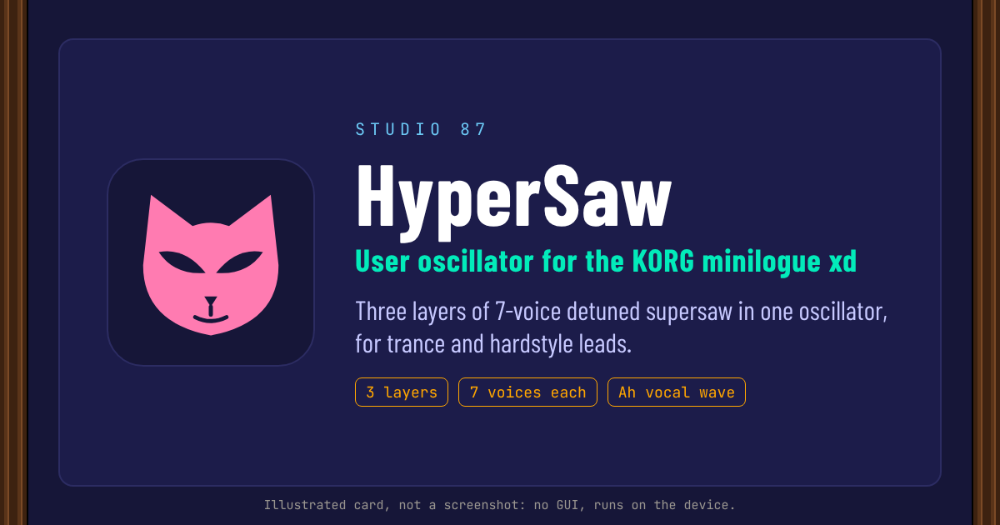
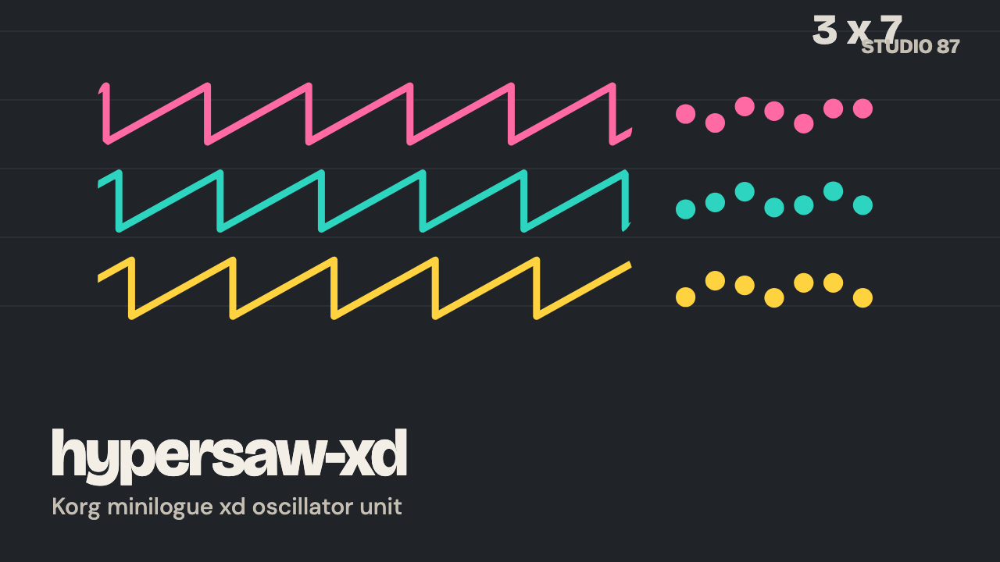

# HyperSaw · minilogue xd user oscillator

Three layers of JP-8000 style supersaw in one oscillator, for the KORG minilogue xd.
Each layer has 7 detuned voices and its own waveform, so you can stack saws, squares, glass and a breathy "Ah" vocal into huge trance and hardstyle leads.

**Download:** [`dist/hypersaw.mnlgxdunit`](dist/hypersaw.mnlgxdunit) · version 1.3

Listen: [`audio/`](audio) has a preview, the Vox Ah sound and a hardstyle demo.

## Install
1. Open **KORG minilogue xd Sound Librarian** and connect the xd by USB.
2. Drag `hypersaw.mnlgxdunit` into a free **User Oscillator** slot.
3. Send to the synth.
4. On the xd: **Multi Engine → USR → HyperSaw**.

## Controls
| Control | What it does |
|---|---|
| SHAPE | Detune (JP-8000 curve). LFO and mod routing can sweep it |
| SHIFT + SHAPE | Mix: center voice vs the 6 side voices |
| Wave A / B / C | Waveform per layer (table below; screen 1 = layer off) |
| Oct B / Oct C | Octave of layer B / C vs layer A, −2 to +2 (the screen shows `%`, read it as octaves) |
| Layer Bal | −100 = only A, 0 = equal, +100 = only B and C |

The xd screen shows Wave A, B and C as **1 to 10** (it counts one higher than the number the code uses):

| Screen | Wave | Screen | Wave |
|---|---|---|---|
| 1 | Off | 6 | Triangle |
| 2 | Supersaw | 7 | Sine |
| 3 | Square | 8 | Glass 1 (bright) |
| 4 | Pulse 25% | 9 | Glass 2 (bell) |
| 5 | Pulse 12% | 10 | Vox Ah (breathy vocal) |

If all three layers are Off (screen 1), layer A plays Supersaw so you never get silence.

## Starter sounds
Values as the screen shows them:
- **Classic JP lead:** A=2, B=1, C=1, Shape ~60%, Shift+Shape ~70%
- **Hypersaw:** A=2, B=2 Oct −1, C=2 Oct +1, Bal 0
- **Trance pad:** A=2, B=3 Oct −1, C=8 Oct +1, Bal −30
- **Hardstyle Ah lead:** A=10, B=2, C=3 Oct −1, Bal −20, Shape ~70%, Shift+Shape ~60%, short decay, sustain ~35%
- **Pure choir:** A=10 only, Shape ~25%, slow attack

Pairs well with [SawWiden](https://github.com/SpeakingColors/sawwiden-xd), our stereo widener mod FX.

## Glitches or dropouts?
3 layers × 7 voices × 4 notes is the heavy case. Set Wave C to 1 (Off) first, then Wave B.

## Status
- Version 1.3, pre-release on GitHub. The unit in `dist/` was built from this repo's source.
- No test on a real minilogue xd is recorded in this repo yet. Linux install steps are not tested yet.
- Docs: [web page](docs/index.html), [INSTALL.txt](packaging/INSTALL.txt). Both are generated from `manifest.json` and `docs/unit-docs.json` by `python3 tools/gen_docs.py`, so the parameter values match what the xd screen shows.

## Build from source
1. Clone the [KORG logue SDK](https://github.com/korginc/logue-sdk) (v1) and install its toolchain.
2. Copy this repo's folder into `logue-sdk/platform/minilogue-xd/hypersaw`.
3. Run `make install` in that folder. The unit file appears next to the Makefile.

Detune and mix curves follow Adam Szabo, "How to Emulate the Super Saw" (2010).

## License
MIT for our code; KORG SDK template files keep their BSD 3-Clause license. See [LICENSE](LICENSE).

Not affiliated with or endorsed by KORG. "minilogue" is used only to say which synth this works with.

## Support

  

☕ Free and open source, made by one person. If it helps your music, a coffee on [Ko-fi](https://ko-fi.com/studio87) keeps it coming. 💜
